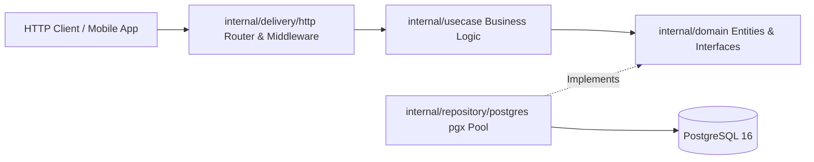

# Go Enterprise API Boilerplate

[](https://github.com/Fahim-Tech-Studio/go-enterprise-api/actions/workflows/ci.yml)
[](https://go.dev/)
[](./internal)
[](LICENSE)

> **Stop rewriting authentication, multi-tenant database connection pooling, graceful shutdowns, and rigid REST routers from scratch for every enterprise client.**

`go-enterprise-api` is a high-performance modular backend architecture and REST API boilerplate built in **Golang**, designed for enterprise resource planning (ERP) systems, real-time dispatch platforms, and scalable microservices.


## Why This Exists

| Enterprise Backend Bottleneck | Built-In Solution |
| :--- | :--- |
| **Tightly Coupled Handlers:** SQL queries mixed directly into HTTP controllers break testability and maintenance. | **Strict Clean Architecture:** Enforces unidirectional dependency flow (`Delivery -> Usecase -> Domain <- Repository`). |
| **Dropped In-Flight Requests:** Abrupt container restarts corrupt active ERP/dispatch transactions. | **Graceful SIGTERM Shutdown:** Drains active HTTP connections cleanly with configurable context timeouts. |
| **Database Connection Leaks:** Poor connection pool management exhausts PostgreSQL limits under heavy load. | **Optimized `pgx` Pooling:** Configured connection limits, health checks, and context timeouts out of the box. |
| **Unstructured Logs:** Plain text logs cannot be parsed effectively by monitoring tools. | **Native Structured JSON Logging:** Emits correlation-ID-tagged JSON logs for seamless observability. |


## Architecture Design



### Repository Structure

```text
go-enterprise-api/
├── cmd/
│   └── api/                 # Application entrypoints
├── internal/
│   ├── delivery/            # HTTP handlers, REST routes, middleware
│   ├── domain/              # Business models and interfaces
│   ├── repository/          # Database queries & data access (PostgreSQL)
│   └── usecase/             # Business logic / application services
├── pkg/                     # Public helper libraries & utilities
├── config/                  # Environment and application configuration
└── go.mod                   # Go modules dependencies

git clone https://github.com/Fahim-Tech-Studio/go-enterprise-api.git
cd go-enterprise-api
go run ./cmd/api/main.go

curl http://localhost:8080/healthz

Key Features & Tech Stack
Modular Routing: Clean separation of handler routes, request IDs, panic recovery, and authentication middleware.

Database Layer: Optimized relational mappings and connection pooling with PostgreSQL (pgx).

Security: JWT-based authentication, role-based access control (RBAC), and request rate limiting.

Observability: Structured JSON logging, request tracing, and Kubernetes-ready health check endpoints (/healthz).

Tech Stack: Go (Golang), PostgreSQL, Chi Router, pgx Driver.

Roadmap
[x] Clean Architecture directory scaffolding & modular routing

[x] Graceful SIGINT/SIGTERM shutdown & /healthz health probes

[x] PostgreSQL connection pooling setup (pgx)

[ ] JWT + Refresh Token RBAC middleware

[ ] Multi-tenant isolation context injection

License
Released under the MIT License. Developed and maintained by Fahim Tech Studio.
